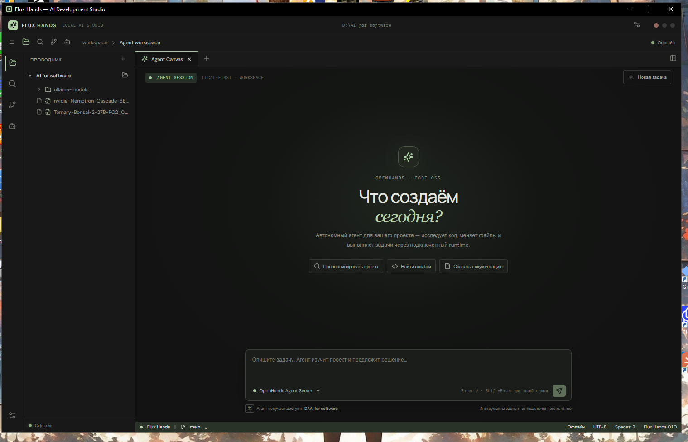

# Flux Hands

Ваша среда разработки. Ваши модели. Ваш контроль.

Flux Hands — Windows-приложение, которое объединяет редактор проекта, локальные языковые модели и автономного агента OpenHands. Вы открываете папку проекта, выбираете GGUF-модель и поручаете агенту изучать и изменять проект из одного рабочего пространства.



## Что уже работает

- Тёмная оболочка приложения с редактором Monaco, проводником и вкладкой агента.
- Открытие папки проекта, просмотр файлов и сохранение изменений.
- Запуск локальной GGUF-модели через `llama-server`; при переключении модели предыдущий процесс останавливается.
- Поиск моделей GGUF на Hugging Face, просмотр файлов и загрузка выбранной модели.
- Локальный OpenHands Agent Server 1.26.0 с потоковым ответом в интерфейсе.
- Передача выбранной модели llama.cpp в профиль OpenHands и привязка агента к текущему проекту.
- Подключение удалённых OpenAI-compatible endpoint-ов; API-ключ хранится в Windows Credential Manager.
- Создание локального ключа Agent Server без учётной записи Flux Hands.

Первый запуск Agent Server скачивает официальный `uv`/`uvx` и нужные Python-пакеты. Для этого требуется интернет. Модель остаётся локальной; её скорость и качество зависят от оборудования и самой модели.

## Скачать для Windows

Последний установщик доступен на странице [релизов Flux Hands](https://github.com/Heepean/Flux-code/releases/latest). Скачайте файл `Flux.Hands_0.2.0_x64-setup.exe` и запустите его.

## Начало работы

1. Установите Flux Hands и откройте папку проекта.
2. Во вкладке **Модели** выберите существующий `.gguf` или найдите модель на Hugging Face.
3. Укажите `llama-server.exe` из сборки llama.cpp и запустите модель.
4. Перейдите в **Agent workspace** и опишите задачу. При первом запуске OpenHands runtime приложение загрузит необходимые Python-компоненты.

Закрытые модели и файлы Hugging Face могут требовать личный токен. Для удалённых моделей укажите адрес API и ключ провайдера; цены и лимиты устанавливает сам провайдер. Локальные модели не требуют учётной записи или ключа.

## Сборка из исходников

Требуются Node.js, Rust toolchain и WebView2 Runtime.

```powershell
npm ci
npm run build
npm run tauri -- dev
```

Создать установщики NSIS и MSI:

```powershell
npm run build:desktop
```

Артефакты появятся в `src-tauri/target/release/bundle/`.

## Следующие части порта

- Встроенное получение и запуск llama.cpp без ручного выбора `llama-server.exe`.
- Подтверждения опасных команд, просмотр терминала, diff и отмена изменений.
- Git, поиск проекта, настройки и дополнительные редакторные инструменты.
- Подготовка полностью автономной установки runtime-компонентов и механизма подписанных обновлений.

Flux Hands развивается как отдельный упрощённый desktop-проект на основе открытых идей VS Code и OpenHands. В репозитории не распространяются архивы их исходных кодов.
